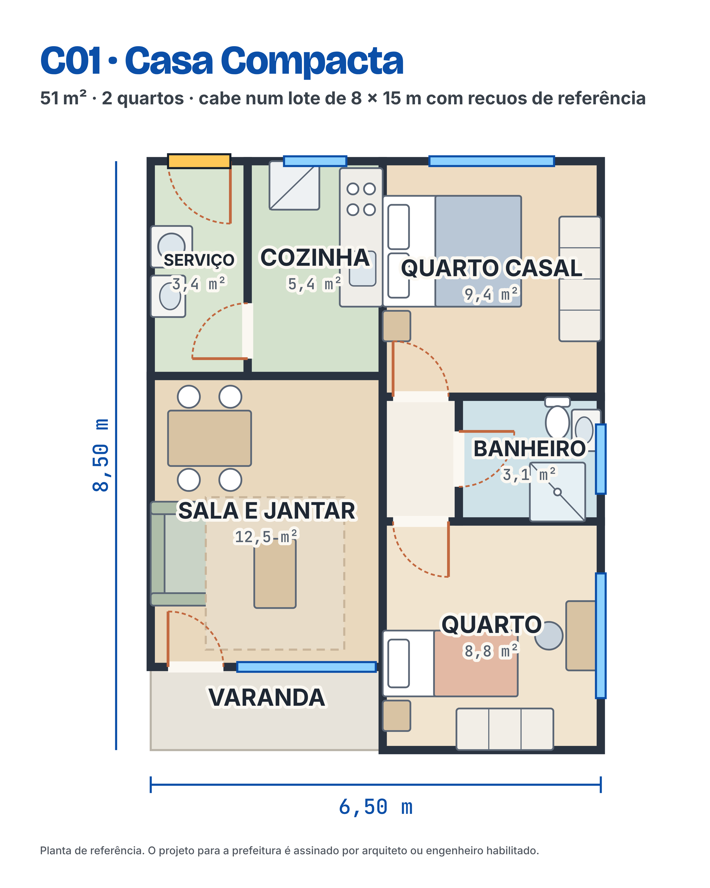
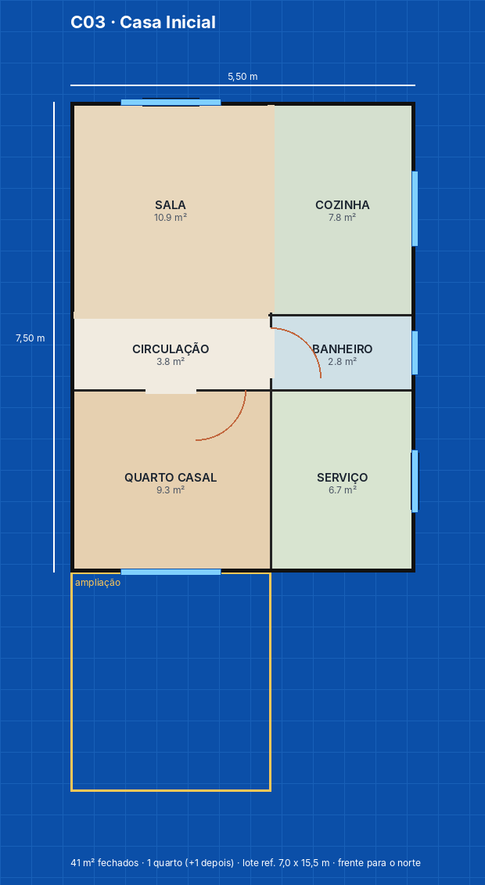
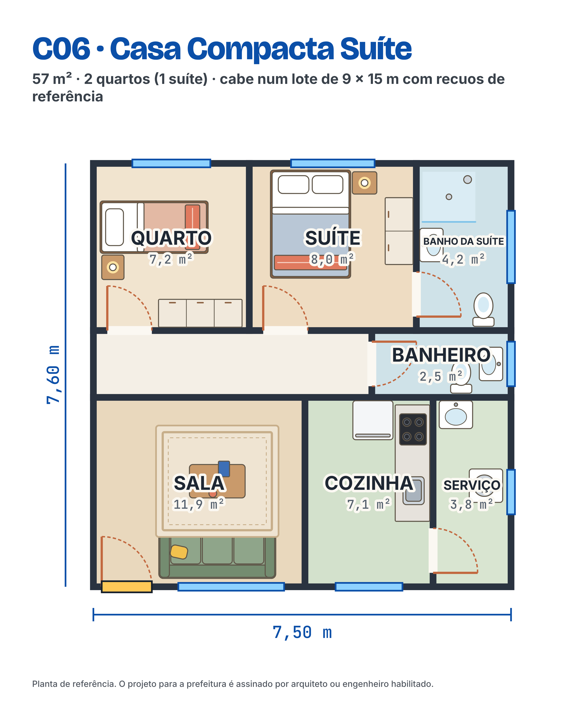
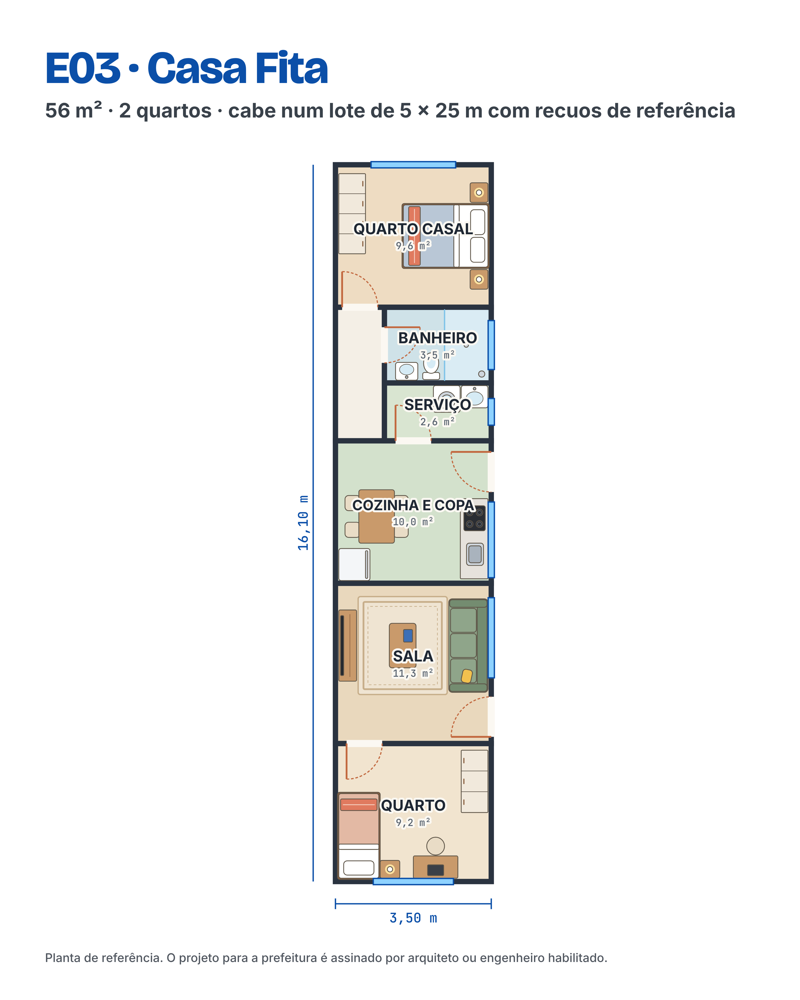
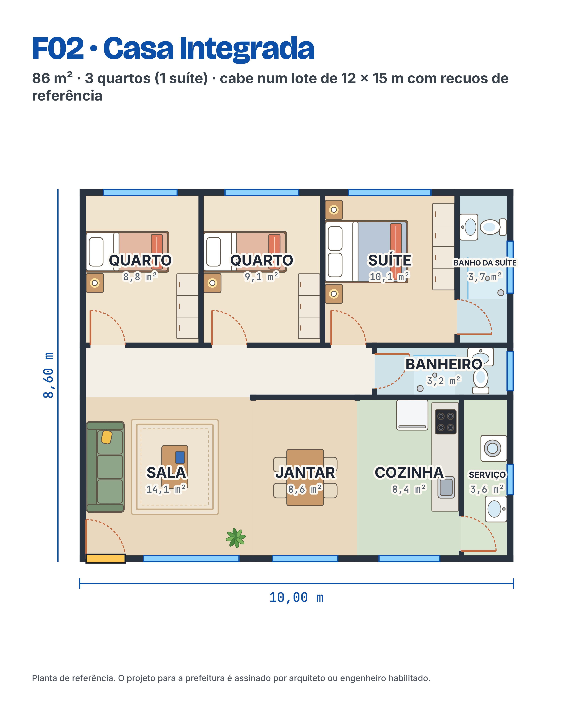
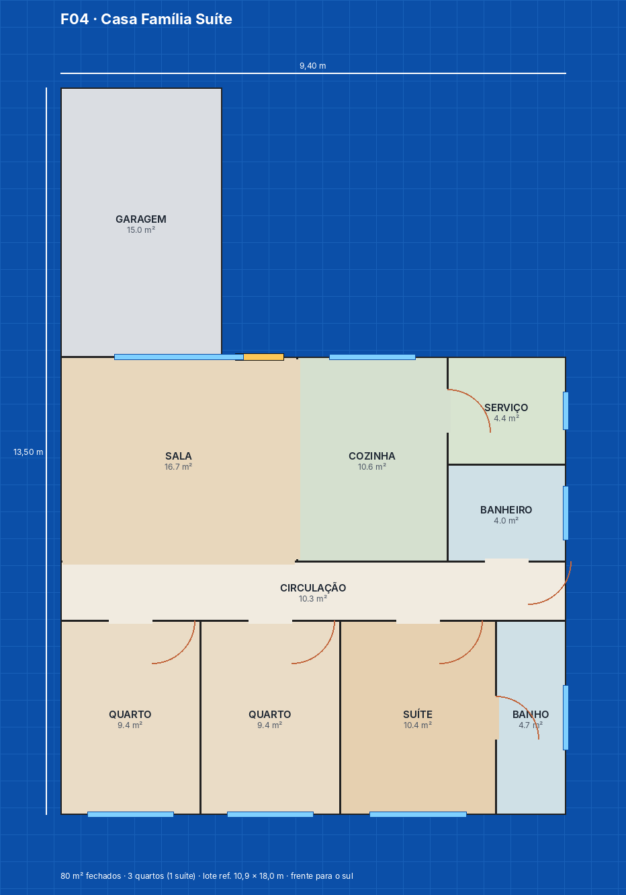
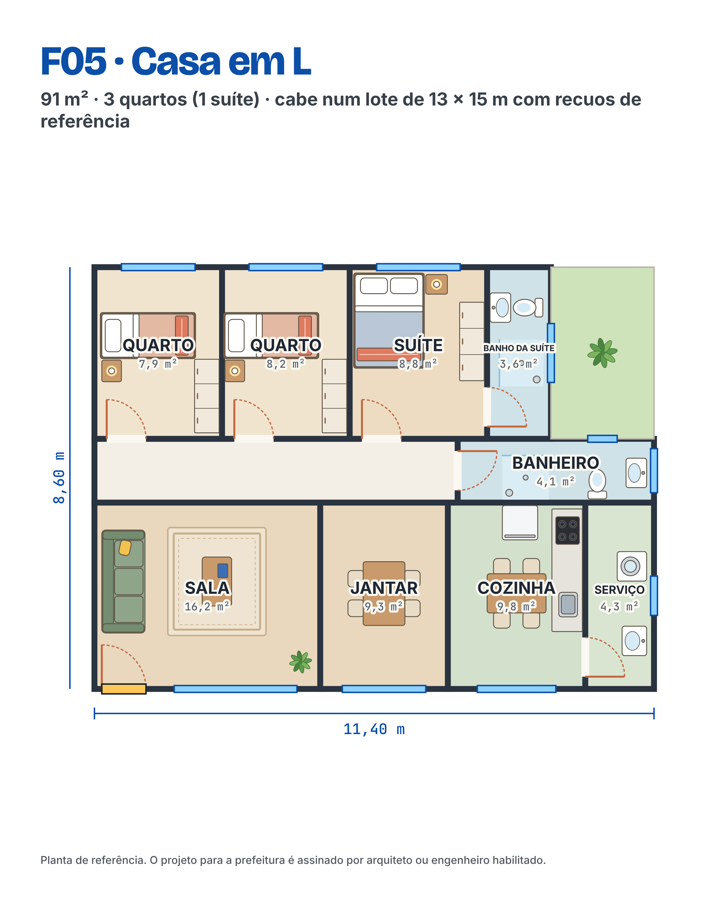
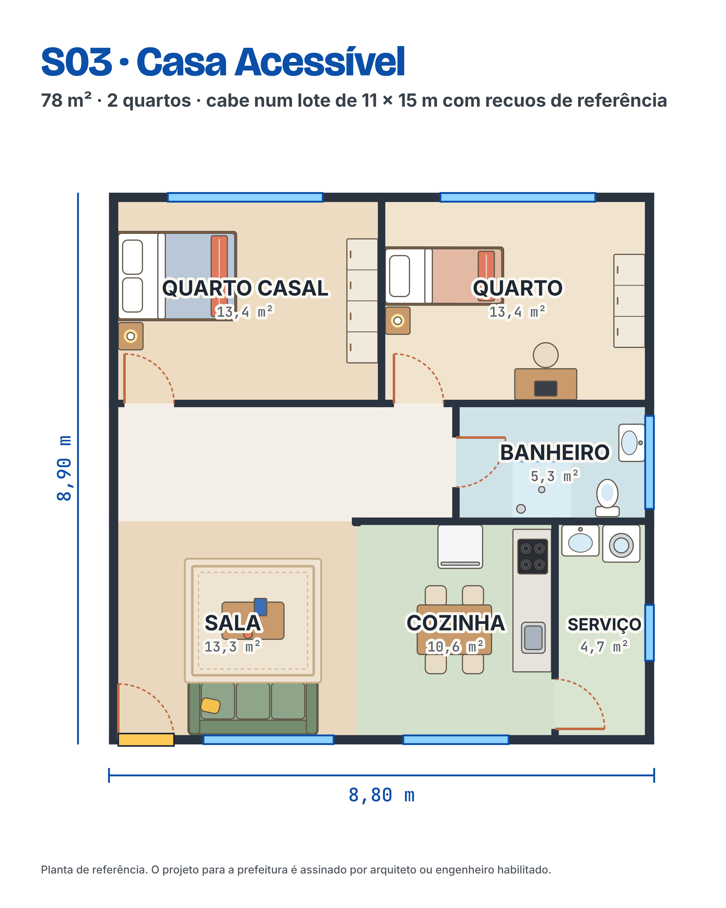
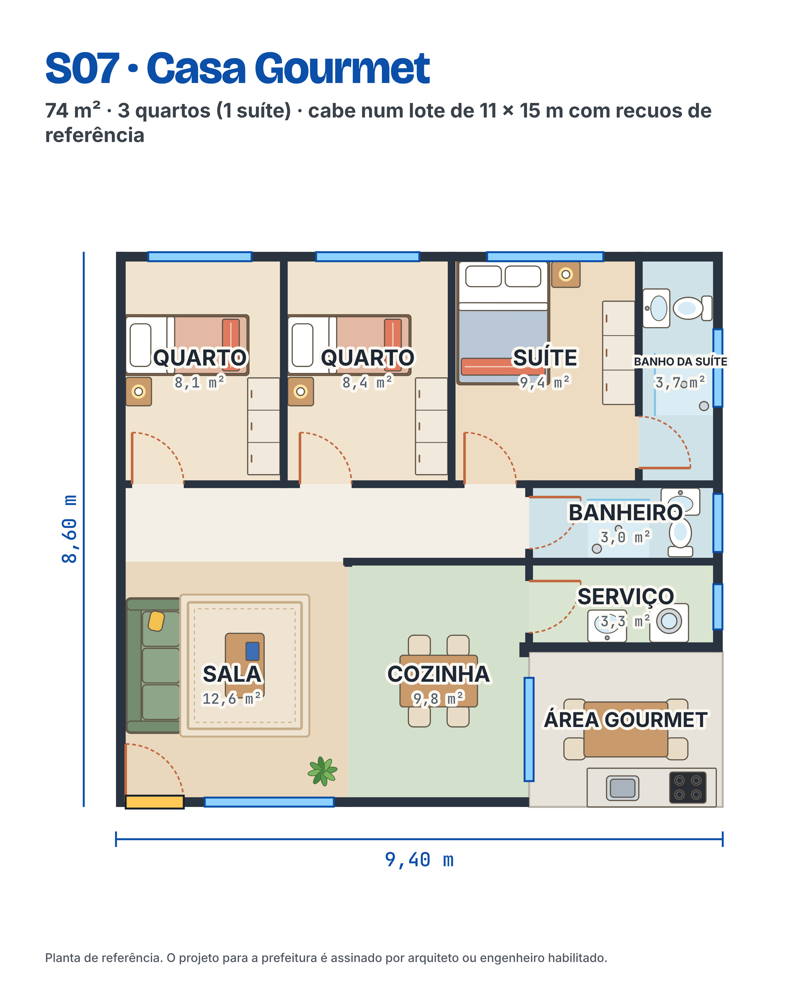

# As 24 plantas: ficha de cada uma

> Gerado por `python3 ferramentas/plantas.py fichas`. Parte da pasta E-book ([`../EBOOK.md`](../EBOOK.md)). Regras: [`../referencias/ARQUITETO.md`](../referencias/ARQUITETO.md). **Plantas de referência**: o projeto para a prefeitura é assinado por arquiteto ou engenheiro habilitado.

## C01 · Casa Compacta

**51 m² fechados** · 2 quartos · 1 banheiro(s) · cabe num lote de **8 x 15 m** (no mínimo 8,0 x 13,0 m) · frente para o **norte**

*Hall curto no lugar do corredor, varanda na entrada e banheiro de 1,84 x 1,68 m livres*

**Por que esta planta é assim**

- Sol: melhor com a rua ao norte; evite a rua ao sul. Se o seu lote for diferente, a planta pode ser espelhada ou as janelas mudadas.
- Varanda: a porta da sala fica coberta, protegida da chuva e do sol direto.
- Áreas molhadas: o banheiro fica longe da cozinha e pede tubulação própria. Pergunte ao engenheiro quanto isso pesa no orçamento.

**Atenção**

- Varanda encosta na divisa da esquerda: essa lateral fica fechada, sem abertura para o vizinho
- Banheiro não encosta em cozinha, serviço ou outro banheiro: prumada própria, um cano que desce só para esse banheiro (custa mais)

## C02 · Casa Studio

**32 m² fechados** · studio · 1 banheiro(s) · cabe num lote de **6 x 15 m** (no mínimo 6,0 x 11,7 m) · frente para o **norte**

**Por que esta planta é assim**

- Sol: melhor com a rua ao norte; evite a rua a oeste. Se o seu lote for diferente, a planta pode ser espelhada ou as janelas mudadas.
- Luz e ar: sala e cozinha têm janela para fora. Nos cômodos onde a família fica (sala e quartos), a janela tem pelo menos um sexto do piso; na cozinha, pelo menos um oitavo (valores de referência; o código de obras da sua cidade pode pedir outro).
- Banheiro colado na cozinha e na área de serviço: os canos ficam juntos, num trecho só, com menos parede para abrir. O traçado final é do engenheiro.

## C03 · Casa Inicial

**41 m² fechados** · 1 quarto (+1 depois) · 1 banheiro(s) · cabe num lote de **7 x 20 m** (no mínimo 7,0 x 15,4 m) · frente para o **norte**

**Por que esta planta é assim**

- Sol: melhor com a rua ao norte; evite a rua a leste. Se o seu lote for diferente, a planta pode ser espelhada ou as janelas mudadas.
- Luz e ar: sala, cozinha e quarto têm janela para fora. Nos cômodos onde a família fica (sala e quartos), a janela tem pelo menos um sexto do piso; na cozinha, pelo menos um oitavo (valores de referência; o código de obras da sua cidade pode pedir outro).
- Banheiro colado na cozinha e na área de serviço: os canos ficam juntos, num trecho só, com menos parede para abrir. O traçado final é do engenheiro.

## C04 · Casa Duo

**48 m² fechados** · 2 quartos · 1 banheiro(s) · cabe num lote de **8 x 15 m** (no mínimo 7,5 x 14,1 m) · frente para o **sul**

*Varanda na frente e dois quartos do mesmo tamanho*

**Por que esta planta é assim**

- Sol: melhor com a rua ao sul; evite a rua a leste. Se o seu lote for diferente, a planta pode ser espelhada ou as janelas mudadas.
- Varanda: a porta da sala fica coberta, protegida da chuva e do sol direto.
- Banheiro colado na cozinha e na área de serviço: os canos ficam juntos, num trecho só, com menos parede para abrir. O traçado final é do engenheiro.

**Atenção**

- Varanda encosta na divisa da esquerda: essa lateral fica fechada, sem abertura para o vizinho

## C05 · Casa Popular

**47 m² fechados** · 2 quartos · 1 banheiro(s) · cabe num lote de **8 x 15 m** (no mínimo 7,5 x 12,3 m) · frente para o **sul**

*A casa de 2 quartos mais enxuta, sem desperdiçar um metro*

**Por que esta planta é assim**

- Sol: melhor com a rua ao sul; evite a rua a leste. Se o seu lote for diferente, a planta pode ser espelhada ou as janelas mudadas.
- Luz e ar: sala, cozinha e quartos têm janela para fora. Nos cômodos onde a família fica (sala e quartos), a janela tem pelo menos um sexto do piso; na cozinha, pelo menos um oitavo (valores de referência; o código de obras da sua cidade pode pedir outro).
- Banheiro colado na cozinha e na área de serviço: os canos ficam juntos, num trecho só, com menos parede para abrir. O traçado final é do engenheiro.

## C06 · Casa Compacta Suíte

**57 m² fechados** · 2 quartos (1 suíte) · 2 banheiro(s) · cabe num lote de **9 x 15 m** (no mínimo 9,0 x 12,1 m) · frente para o **sul**

**Por que esta planta é assim**

- Sol: melhor com a rua ao sul; evite a rua a leste. Se o seu lote for diferente, a planta pode ser espelhada ou as janelas mudadas.
- Luz e ar: sala, cozinha e quartos têm janela para fora. Nos cômodos onde a família fica (sala e quartos), a janela tem pelo menos um sexto do piso; na cozinha, pelo menos um oitavo (valores de referência; o código de obras da sua cidade pode pedir outro).
- Banheiro colado na cozinha e na área de serviço: os canos ficam juntos, num trecho só, com menos parede para abrir. O traçado final é do engenheiro.

## C07 · Casa Compacta Varanda

**55 m² fechados** · 2 quartos · 1 banheiro(s) · cabe num lote de **8 x 15 m** (no mínimo 8,0 x 14,8 m) · frente para o **sul**

*Varanda larga para a rede e a cadeira de fim de tarde*

**Por que esta planta é assim**

- Sol: melhor com a rua ao sul; evite a rua a leste. Se o seu lote for diferente, a planta pode ser espelhada ou as janelas mudadas.
- Varanda: a porta da sala fica coberta, protegida da chuva e do sol direto.
- Banheiro colado na cozinha e na área de serviço: os canos ficam juntos, num trecho só, com menos parede para abrir. O traçado final é do engenheiro.

**Atenção**

- Varanda encosta na divisa da esquerda: essa lateral fica fechada, sem abertura para o vizinho

## E01 · Casa Estreita

**58 m² fechados** · 2 quartos (1 suíte) · 2 banheiro(s) · cabe num lote de **8 x 25 m** (no mínimo 8,0 x 23,7 m) · frente para o **norte**

*Garagem na frente e todos os cômodos abrindo para o corredor*

**Por que esta planta é assim**

- Sol: melhor com a rua ao norte; evite a rua ao sul. Se o seu lote for diferente, a planta pode ser espelhada ou as janelas mudadas.
- Corredor coberto ao lado: todos os cômodos abrem para ele e ganham janela, mesmo num lote estreito. Da sala para o banheiro e os quartos se passa por ele, então vale fechar a frente com portão. O código de obras da sua cidade diz se janela para área coberta conta como ventilação.
- Banheiro colado na cozinha e na área de serviço: os canos ficam juntos, num trecho só, com menos parede para abrir. O traçado final é do engenheiro.

**Atenção**

- Suíte fica com 2,49 x 3,08 m livres (7,7 m²): funciona, mas é apertado; o engenheiro confere a mobília

## E02 · Casa Corredor

**40 m² fechados** · 2 quartos · 1 banheiro(s) · cabe num lote de **7 x 20 m** (no mínimo 6,6 x 19,8 m) · frente para o **norte**

**Por que esta planta é assim**

- Sol: melhor com a rua ao norte; evite a rua ao sul. Se o seu lote for diferente, a planta pode ser espelhada ou as janelas mudadas.
- Corredor coberto ao lado: todos os cômodos abrem para ele e ganham janela, mesmo num lote estreito. Da sala para o banheiro e os quartos se passa por ele, então vale fechar a frente com portão. O código de obras da sua cidade diz se janela para área coberta conta como ventilação.
- Banheiro colado na cozinha e na área de serviço: os canos ficam juntos, num trecho só, com menos parede para abrir. O traçado final é do engenheiro.

**Atenção**

- Sala fica com 2,30 x 3,75 m livres (8,6 m²): funciona, mas é apertado; o engenheiro confere a mobília
- Quarto casal fica com 2,30 x 3,18 m livres (7,3 m²): funciona, mas é apertado; o engenheiro confere a mobília

## E03 · Casa Fita

**56 m² fechados** · 2 quartos · 1 banheiro(s) · cabe num lote de **5 x 25 m** (no mínimo 5,0 x 20,6 m) · frente para o **norte**

*Dois quartos num lote de 5 m: um em cada ponta, sala e copa no meio, banheiro por dentro de casa*

**Por que esta planta é assim**

- Sol: melhor com a rua ao norte; evite a rua ao sul. Se o seu lote for diferente, a planta pode ser espelhada ou as janelas mudadas.
- Luz e ar: sala, cozinha e quartos têm janela para fora. Nos cômodos onde a família fica (sala e quartos), a janela tem pelo menos um sexto do piso; na cozinha, pelo menos um oitavo (valores de referência; o código de obras da sua cidade pode pedir outro).
- Banheiro colado na área de serviço: os canos ficam juntos, num trecho só, com menos parede para abrir. O traçado final é do engenheiro.

## E04 · Casa Pátio

**55 m² fechados** · 2 quartos · 1 banheiro(s) · cabe num lote de **9 x 15 m** (no mínimo 9,0 x 12,5 m) · frente para o **norte**

*Pátio de luz entre os quartos: o quarto casal abre janela para ele*

**Por que esta planta é assim**

- Sol: melhor com a rua ao norte; evite a rua a leste. Se o seu lote for diferente, a planta pode ser espelhada ou as janelas mudadas.
- Pátio de luz: o quarto casal abre janela para o pátio, com luz e ar sem dar para o vizinho.
- Banheiro colado na cozinha e na área de serviço: os canos ficam juntos, num trecho só, com menos parede para abrir. O traçado final é do engenheiro.

## E05 · Casa Estreita Suíte

**59 m² fechados** · 2 quartos (1 suíte) · 2 banheiro(s) · cabe num lote de **8 x 20 m** (no mínimo 7,9 x 19,5 m) · frente para o **norte**

**Por que esta planta é assim**

- Sol: melhor com a rua ao norte; evite a rua ao sul. Se o seu lote for diferente, a planta pode ser espelhada ou as janelas mudadas.
- Corredor coberto ao lado: todos os cômodos abrem para ele e ganham janela, mesmo num lote estreito. Da sala para o banheiro e os quartos se passa por ele, então vale fechar a frente com portão. O código de obras da sua cidade diz se janela para área coberta conta como ventilação.
- Banheiro colado na cozinha e na área de serviço: os canos ficam juntos, num trecho só, com menos parede para abrir. O traçado final é do engenheiro.

**Atenção**

- Suíte fica com 2,39 x 3,28 m livres (7,8 m²): funciona, mas é apertado; o engenheiro confere a mobília

## E06 · Casa Estreita Gourmet

**68 m² fechados** · 2 quartos (1 suíte) · 2 banheiro(s) · cabe num lote de **9 x 25 m** (no mínimo 8,6 x 22,5 m) · frente para o **norte**

*Área gourmet nos fundos, aberta para o corredor*

**Por que esta planta é assim**

- Sol: melhor com a rua ao norte; evite a rua ao sul. Se o seu lote for diferente, a planta pode ser espelhada ou as janelas mudadas.
- Corredor coberto ao lado: todos os cômodos abrem para ele e ganham janela, mesmo num lote estreito. Da sala para o banheiro e os quartos se passa por ele, então vale fechar a frente com portão. O código de obras da sua cidade diz se janela para área coberta conta como ventilação.
- Banheiro colado na cozinha e na área de serviço: os canos ficam juntos, num trecho só, com menos parede para abrir. O traçado final é do engenheiro.

- Sala tem vão de 4.6 m: o engenheiro confere laje e vigas
- Cozinha tem vão de 4.6 m: o engenheiro confere laje e vigas
- Quarto tem vão de 4.6 m: o engenheiro confere laje e vigas

## E07 · Casa Estreita 3 Quartos

**72 m² fechados** · 3 quartos (1 suíte) · 2 banheiro(s) · cabe num lote de **8 x 25 m** (no mínimo 8,0 x 22,4 m) · frente para o **norte**

*3 quartos, um deles suíte, num lote de 8 m de frente*

**Por que esta planta é assim**

- Sol: melhor com a rua ao norte; evite a rua ao sul. Se o seu lote for diferente, a planta pode ser espelhada ou as janelas mudadas.
- Corredor coberto ao lado: todos os cômodos abrem para ele e ganham janela, mesmo num lote estreito. Da sala para o banheiro e os quartos se passa por ele, então vale fechar a frente com portão. O código de obras da sua cidade diz se janela para área coberta conta como ventilação.
- Áreas molhadas: o banheiro da suíte fica longe da cozinha e pede tubulação própria. Pergunte ao engenheiro quanto isso pesa no orçamento.

**Atenção**

- Suíte fica com 2,49 x 3,09 m livres (7,7 m²): funciona, mas é apertado; o engenheiro confere a mobília
- Banho da suíte não encosta em cozinha, serviço ou outro banheiro: prumada própria, um cano que desce só para esse banheiro (custa mais)

## F01 · Casa Família Compacta

**71 m² fechados** · 3 quartos · 1 banheiro(s) · cabe num lote de **10 x 15 m** (no mínimo 10,0 x 12,8 m) · frente para o **sul**

**Por que esta planta é assim**

- Sol: melhor com a rua ao sul; evite a rua a leste. Se o seu lote for diferente, a planta pode ser espelhada ou as janelas mudadas.
- Luz e ar: sala, cozinha e quartos têm janela para fora. Nos cômodos onde a família fica (sala e quartos), a janela tem pelo menos um sexto do piso; na cozinha, pelo menos um oitavo (valores de referência; o código de obras da sua cidade pode pedir outro).
- Banheiro colado na cozinha e na área de serviço: os canos ficam juntos, num trecho só, com menos parede para abrir. O traçado final é do engenheiro.

- Sala e jantar tem vão de 4.6 m: o engenheiro confere laje e vigas

## F02 · Casa Integrada

**86 m² fechados** · 3 quartos (1 suíte) · 2 banheiro(s) · cabe num lote de **12 x 15 m** (no mínimo 11,5 x 13,1 m) · frente para o **sul**

**Por que esta planta é assim**

- Sol: melhor com a rua ao sul; evite a rua a leste. Se o seu lote for diferente, a planta pode ser espelhada ou as janelas mudadas.
- Luz e ar: sala, cozinha e quartos têm janela para fora. Nos cômodos onde a família fica (sala e quartos), a janela tem pelo menos um sexto do piso; na cozinha, pelo menos um oitavo (valores de referência; o código de obras da sua cidade pode pedir outro).
- Banheiro colado na cozinha e na área de serviço: os canos ficam juntos, num trecho só, com menos parede para abrir. O traçado final é do engenheiro.

## F03 · Casa Família

**78 m² fechados** · 3 quartos (1 suíte) · 2 banheiro(s) · cabe num lote de **11 x 15 m** (no mínimo 10,9 x 14,6 m) · frente para o **sul**

**Por que esta planta é assim**

- Sol: melhor com a rua ao sul; evite a rua a leste. Se o seu lote for diferente, a planta pode ser espelhada ou as janelas mudadas.
- Varanda: a porta da sala fica coberta, protegida da chuva e do sol direto.
- Áreas molhadas: o banheiro da suíte fica longe da cozinha e pede tubulação própria. Pergunte ao engenheiro quanto isso pesa no orçamento.

**Atenção**

- Varanda encosta na divisa da esquerda: essa lateral fica fechada, sem abertura para o vizinho
- Banho da suíte não encosta em cozinha, serviço ou outro banheiro: prumada própria, um cano que desce só para esse banheiro (custa mais)

## F04 · Casa Família Suíte

**80 m² fechados** · 3 quartos (1 suíte) · 2 banheiro(s) · cabe num lote de **11 x 20 m** (no mínimo 10,9 x 18,0 m) · frente para o **sul**

**Por que esta planta é assim**

- Sol: melhor com a rua ao sul; evite a rua a leste. Se o seu lote for diferente, a planta pode ser espelhada ou as janelas mudadas.
- Luz e ar: sala, cozinha e quartos têm janela para fora. Nos cômodos onde a família fica (sala e quartos), a janela tem pelo menos um sexto do piso; na cozinha, pelo menos um oitavo (valores de referência; o código de obras da sua cidade pode pedir outro).
- Áreas molhadas: o banheiro da suíte fica longe da cozinha e pede tubulação própria. Pergunte ao engenheiro quanto isso pesa no orçamento.

**Atenção**

- Banho da suíte não encosta em cozinha, serviço ou outro banheiro: prumada própria, um cano que desce só para esse banheiro (custa mais)

## F05 · Casa em L

**91 m² fechados** · 3 quartos (1 suíte) · 2 banheiro(s) · cabe num lote de **13 x 15 m** (no mínimo 12,9 x 13,1 m) · frente para o **sul**

**Por que esta planta é assim**

- Sol: melhor com a rua ao sul; evite a rua a leste. Se o seu lote for diferente, a planta pode ser espelhada ou as janelas mudadas.
- Luz e ar: sala, cozinha e quartos têm janela para fora. Nos cômodos onde a família fica (sala e quartos), a janela tem pelo menos um sexto do piso; na cozinha, pelo menos um oitavo (valores de referência; o código de obras da sua cidade pode pedir outro).
- Banheiro colado na cozinha e na área de serviço: os canos ficam juntos, num trecho só, com menos parede para abrir. O traçado final é do engenheiro.

- Sala tem vão de 4.6 m: o engenheiro confere laje e vigas

## S03 · Casa Acessível

**78 m² fechados** · 2 quartos · 1 banheiro(s) · cabe num lote de **11 x 15 m** (no mínimo 10,3 x 13,4 m) · frente para o **sul**

*Circulação larga e banheiro com espaço livre para o giro de 1,50 m da cadeira de rodas*

**Por que esta planta é assim**

- Sol: melhor com a rua ao sul; evite a rua a leste. Se o seu lote for diferente, a planta pode ser espelhada ou as janelas mudadas.
- Luz e ar: sala, cozinha e quartos têm janela para fora. Nos cômodos onde a família fica (sala e quartos), a janela tem pelo menos um sexto do piso; na cozinha, pelo menos um oitavo (valores de referência; o código de obras da sua cidade pode pedir outro).
- Banheiro colado na cozinha e na área de serviço: os canos ficam juntos, num trecho só, com menos parede para abrir. O traçado final é do engenheiro.

- Casa acessível: o engenheiro confere o resto da NBR 9050 (barras, portas, área de transferência, entrada sem degrau)

## S04 · Casa Home Office

**66 m² fechados** · 2 quartos + escritório · 1 banheiro(s) · cabe num lote de **10 x 20 m** (no mínimo 9,3 x 15,3 m) · frente para o **sul**

*Escritório com porta para a rua: cliente entra sem passar pela casa*

**Por que esta planta é assim**

- Sol: melhor com a rua ao sul; evite a rua a leste. Se o seu lote for diferente, a planta pode ser espelhada ou as janelas mudadas.
- Varanda: a porta da sala fica coberta, protegida da chuva e do sol direto.
- Banheiro colado na cozinha e na área de serviço: os canos ficam juntos, num trecho só, com menos parede para abrir. O traçado final é do engenheiro.

- Sala tem vão de 4.8 m: o engenheiro confere laje e vigas

## S05 · Casa de Praia

**59 m² fechados** · 2 quartos (1 suíte) · 2 banheiro(s) · cabe num lote de **9 x 15 m** (no mínimo 8,9 x 14,9 m) · frente para o **sul**

*Varandão na frente e suíte para o casal*

**Por que esta planta é assim**

- Sol: melhor com a rua ao sul; evite a rua a leste. Se o seu lote for diferente, a planta pode ser espelhada ou as janelas mudadas.
- Varanda: a porta da sala fica coberta, protegida da chuva e do sol direto.
- Banheiro colado na cozinha e na área de serviço: os canos ficam juntos, num trecho só, com menos parede para abrir. O traçado final é do engenheiro.

**Atenção**

- Varandão encosta na divisa da esquerda: essa lateral fica fechada, sem abertura para o vizinho

## S07 · Casa Gourmet

**74 m² fechados** · 3 quartos (1 suíte) · 2 banheiro(s) · cabe num lote de **11 x 15 m** (no mínimo 10,9 x 13,1 m) · frente para o **sul**

*Cozinha aberta para a área gourmet, a casa que recebe*

**Por que esta planta é assim**

- Sol: melhor com a rua ao sul; evite a rua a leste. Se o seu lote for diferente, a planta pode ser espelhada ou as janelas mudadas.
- Luz e ar: sala, cozinha e quartos têm janela para fora. Nos cômodos onde a família fica (sala e quartos), a janela tem pelo menos um sexto do piso; na cozinha, pelo menos um oitavo (valores de referência; o código de obras da sua cidade pode pedir outro).
- Banheiro colado na área de serviço e no outro banheiro: os canos ficam juntos, num trecho só, com menos parede para abrir. O traçado final é do engenheiro.

## S09 · Casa de Esquina

**78 m² fechados** · 3 quartos (1 suíte) · 2 banheiro(s) · cabe num lote de **14 x 15 m** (no mínimo 13,9 x 14,6 m) · frente para o **sul**

**Por que esta planta é assim**

- Sol: melhor com a rua ao sul; evite a rua a leste. Se o seu lote for diferente, a planta pode ser espelhada ou as janelas mudadas.
- Varanda: a porta da sala fica coberta, protegida da chuva e do sol direto.
- Áreas molhadas: o banheiro da suíte fica longe da cozinha e pede tubulação própria. Pergunte ao engenheiro quanto isso pesa no orçamento.

**Atenção**

- Banho da suíte não encosta em cozinha, serviço ou outro banheiro: prumada própria, um cano que desce só para esse banheiro (custa mais)
