# As 24 plantas: ficha de cada uma

> Gerado por `python3 ferramentas/plantas.py fichas`. Parte da pasta E-book ([`../EBOOK.md`](../EBOOK.md)). Regras: [`../referencias/regras-do-arquiteto.md`](../referencias/regras-do-arquiteto.md). **Plantas de referência**: o projeto para a prefeitura é assinado por arquiteto ou engenheiro habilitado.

## C01 · Casa Compacta

**55 m² fechados** · 2 quartos · 1 banheiro(s) · lote a partir de **8 x 15 m** · frente para o **sul**

*A casa mais enxuta que ainda tem 2 quartos separados e serviço coberto*

**Por que esta planta é assim**

- Sol: testamos as quatro orientações para as janelas desta planta. Ela funciona melhor com a frente para o sul e pior para o leste (critério simplificado; o arquiteto confere para o clima da sua cidade). Se o seu lote for diferente, a planta pode ser espelhada ou as janelas mudadas.
- Luz e ar: sala, cozinha e quartos têm janela para fora, com pelo menos um sexto do piso nos cômodos de permanência (valor de referência; o código de obras da sua cidade pode pedir outro).
- Áreas molhadas juntas: o banheiro encosta em outra área molhada, e a tubulação pode ficar concentrada. O traçado final é do engenheiro.

## C02 · Casa Studio

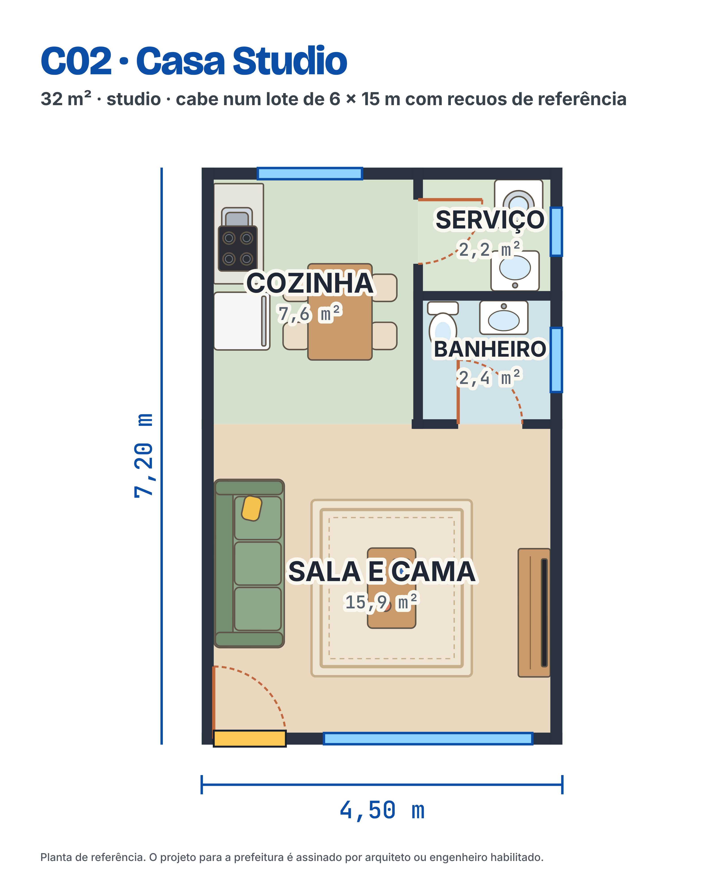

**32 m² fechados** · studio · 1 banheiro(s) · lote a partir de **6 x 15 m** · frente para o **norte**

**Por que esta planta é assim**

- Sol: testamos as quatro orientações para as janelas desta planta. Ela funciona melhor com a frente para o norte e pior para o oeste (critério simplificado; o arquiteto confere para o clima da sua cidade). Se o seu lote for diferente, a planta pode ser espelhada ou as janelas mudadas.
- Luz e ar: sala, cozinha e quartos têm janela para fora, com pelo menos um sexto do piso nos cômodos de permanência (valor de referência; o código de obras da sua cidade pode pedir outro).
- Áreas molhadas juntas: o banheiro encosta em outra área molhada, e a tubulação pode ficar concentrada. O traçado final é do engenheiro.

## C03 · Casa Inicial

**41 m² fechados** · 1 quarto (+1 depois) · 1 banheiro(s) · lote a partir de **7 x 20 m** · frente para o **norte**

**Por que esta planta é assim**

- Sol: testamos as quatro orientações para as janelas desta planta. Ela funciona melhor com a frente para o norte e pior para o leste (critério simplificado; o arquiteto confere para o clima da sua cidade). Se o seu lote for diferente, a planta pode ser espelhada ou as janelas mudadas.
- Luz e ar: sala, cozinha e quartos têm janela para fora, com pelo menos um sexto do piso nos cômodos de permanência (valor de referência; o código de obras da sua cidade pode pedir outro).
- Áreas molhadas juntas: o banheiro encosta em outra área molhada, e a tubulação pode ficar concentrada. O traçado final é do engenheiro.

## C04 · Casa Duo

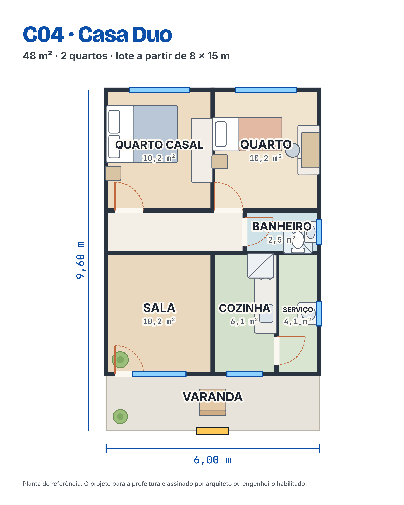

**48 m² fechados** · 2 quartos · 1 banheiro(s) · lote a partir de **8 x 15 m** · frente para o **sul**

*Varanda na frente e dois quartos do mesmo tamanho*

**Por que esta planta é assim**

- Sol: testamos as quatro orientações para as janelas desta planta. Ela funciona melhor com a frente para o sul e pior para o leste (critério simplificado; o arquiteto confere para o clima da sua cidade). Se o seu lote for diferente, a planta pode ser espelhada ou as janelas mudadas.
- Varanda: a porta da sala fica coberta, protegida da chuva e do sol direto.
- Áreas molhadas juntas: o banheiro encosta em outra área molhada, e a tubulação pode ficar concentrada. O traçado final é do engenheiro.

## C05 · Casa Popular

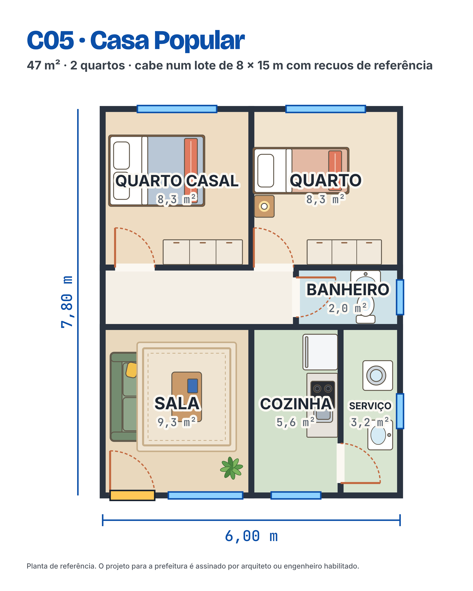

**47 m² fechados** · 2 quartos · 1 banheiro(s) · lote a partir de **8 x 15 m** · frente para o **sul**

*A casa de 2 quartos mais enxuta, sem desperdiçar um metro*

**Por que esta planta é assim**

- Sol: testamos as quatro orientações para as janelas desta planta. Ela funciona melhor com a frente para o sul e pior para o leste (critério simplificado; o arquiteto confere para o clima da sua cidade). Se o seu lote for diferente, a planta pode ser espelhada ou as janelas mudadas.
- Luz e ar: sala, cozinha e quartos têm janela para fora, com pelo menos um sexto do piso nos cômodos de permanência (valor de referência; o código de obras da sua cidade pode pedir outro).
- Áreas molhadas juntas: o banheiro encosta em outra área molhada, e a tubulação pode ficar concentrada. O traçado final é do engenheiro.

## C06 · Casa Compacta Suíte

**57 m² fechados** · 2 quartos (1 suíte) · 2 banheiro(s) · lote a partir de **9 x 15 m** · frente para o **sul**

**Por que esta planta é assim**

- Sol: testamos as quatro orientações para as janelas desta planta. Ela funciona melhor com a frente para o sul e pior para o leste (critério simplificado; o arquiteto confere para o clima da sua cidade). Se o seu lote for diferente, a planta pode ser espelhada ou as janelas mudadas.
- Luz e ar: sala, cozinha e quartos têm janela para fora, com pelo menos um sexto do piso nos cômodos de permanência (valor de referência; o código de obras da sua cidade pode pedir outro).
- Áreas molhadas juntas: o banheiro encosta em outra área molhada, e a tubulação pode ficar concentrada. O traçado final é do engenheiro.

## C07 · Casa Compacta Varanda

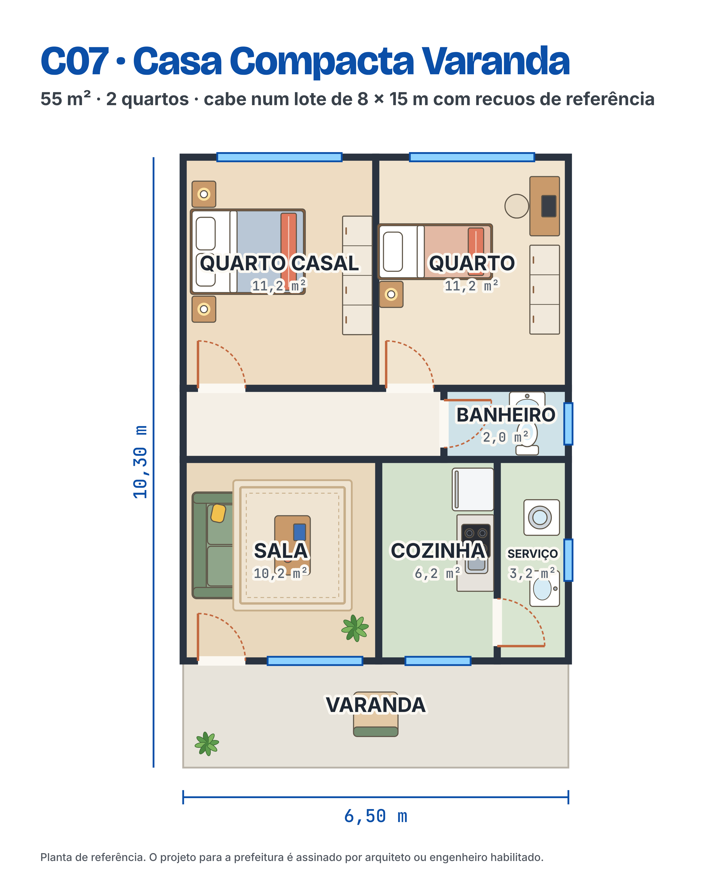

**55 m² fechados** · 2 quartos · 1 banheiro(s) · lote a partir de **8 x 15 m** · frente para o **sul**

*Varanda larga para a rede e a cadeira de fim de tarde*

**Por que esta planta é assim**

- Sol: testamos as quatro orientações para as janelas desta planta. Ela funciona melhor com a frente para o sul e pior para o leste (critério simplificado; o arquiteto confere para o clima da sua cidade). Se o seu lote for diferente, a planta pode ser espelhada ou as janelas mudadas.
- Varanda: a porta da sala fica coberta, protegida da chuva e do sol direto.
- Áreas molhadas juntas: o banheiro encosta em outra área molhada, e a tubulação pode ficar concentrada. O traçado final é do engenheiro.

## E01 · Casa Estreita

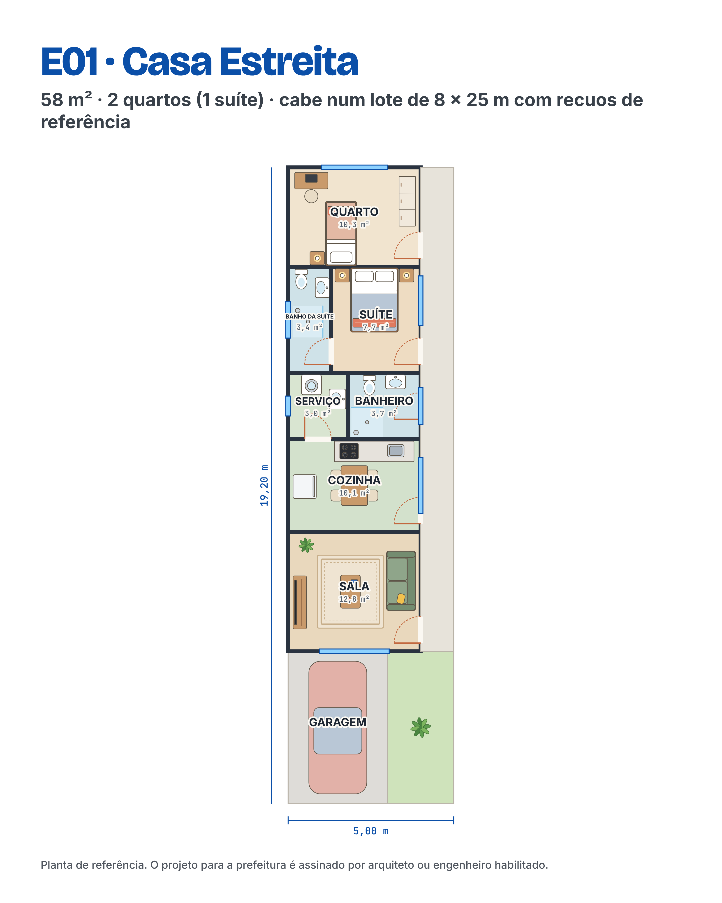

**58 m² fechados** · 2 quartos (1 suíte) · 2 banheiro(s) · lote a partir de **8 x 25 m** · frente para o **norte**

*Garagem na frente e todos os cômodos abrindo para o corredor*

**Por que esta planta é assim**

- Sol: testamos as quatro orientações para as janelas desta planta. Ela funciona melhor com a frente para o norte e pior para o sul (critério simplificado; o arquiteto confere para o clima da sua cidade). Se o seu lote for diferente, a planta pode ser espelhada ou as janelas mudadas.
- Corredor coberto ao lado: todos os cômodos abrem para ele e ganham janela, mesmo num lote estreito, sem corredor dentro de casa.
- Áreas molhadas juntas: o banheiro encosta em outra área molhada, e a tubulação pode ficar concentrada. O traçado final é do engenheiro.

## E02 · Casa Corredor

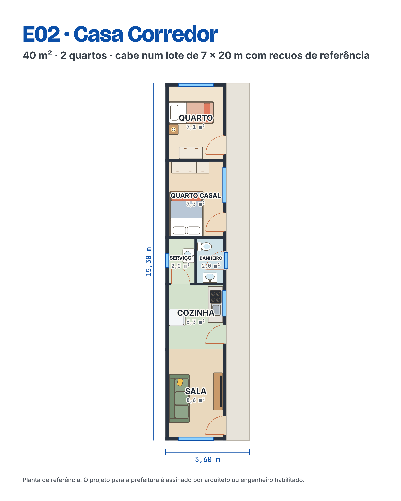

**40 m² fechados** · 2 quartos · 1 banheiro(s) · lote a partir de **7 x 20 m** · frente para o **norte**

**Por que esta planta é assim**

- Sol: testamos as quatro orientações para as janelas desta planta. Ela funciona melhor com a frente para o norte e pior para o sul (critério simplificado; o arquiteto confere para o clima da sua cidade). Se o seu lote for diferente, a planta pode ser espelhada ou as janelas mudadas.
- Corredor coberto ao lado: todos os cômodos abrem para ele e ganham janela, mesmo num lote estreito, sem corredor dentro de casa.
- Áreas molhadas juntas: o banheiro encosta em outra área molhada, e a tubulação pode ficar concentrada. O traçado final é do engenheiro.

## E03 · Casa Fita

**34 m² fechados** · 1 quarto · 1 banheiro(s) · lote a partir de **5 x 20 m** · frente para o **norte**

*Cabe em lote de 5 m de frente: todas as janelas dão para o corredor*

**Por que esta planta é assim**

- Sol: testamos as quatro orientações para as janelas desta planta. Ela funciona melhor com a frente para o norte e pior para o leste (critério simplificado; o arquiteto confere para o clima da sua cidade). Se o seu lote for diferente, a planta pode ser espelhada ou as janelas mudadas.
- Corredor coberto ao lado: todos os cômodos abrem para ele e ganham janela, mesmo num lote estreito, sem corredor dentro de casa.
- Áreas molhadas juntas: o banheiro encosta em outra área molhada, e a tubulação pode ficar concentrada. O traçado final é do engenheiro.

## E04 · Casa Pátio

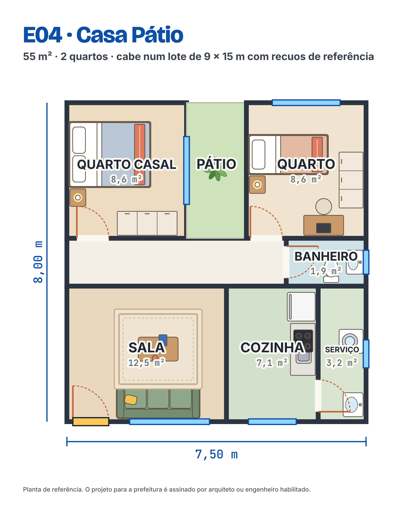

**55 m² fechados** · 2 quartos · 1 banheiro(s) · lote a partir de **9 x 15 m** · frente para o **sul**

*Pátio de luz entre os quartos: ventilação cruzada e privacidade*

**Por que esta planta é assim**

- Sol: testamos as quatro orientações para as janelas desta planta. Ela funciona melhor com a frente para o sul e pior para o leste (critério simplificado; o arquiteto confere para o clima da sua cidade). Se o seu lote for diferente, a planta pode ser espelhada ou as janelas mudadas.
- Pátio de luz: os quartos ganham janela para o pátio, com luz e ar sem abrir a casa para o vizinho.
- Áreas molhadas juntas: o banheiro encosta em outra área molhada, e a tubulação pode ficar concentrada. O traçado final é do engenheiro.

## E05 · Casa Estreita Suíte

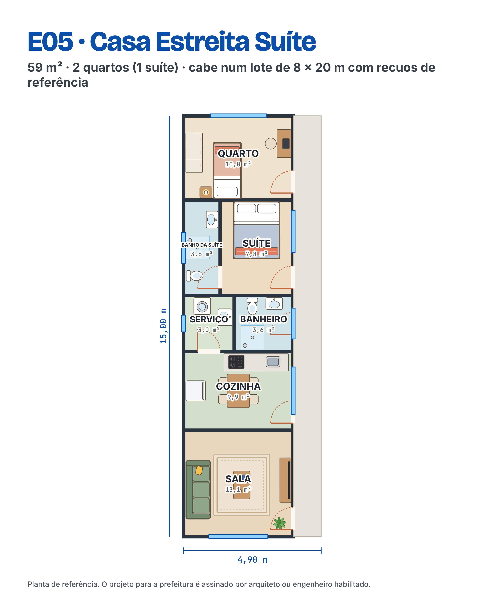

**58 m² fechados** · 2 quartos (1 suíte) · 2 banheiro(s) · lote a partir de **8 x 20 m** · frente para o **norte**

**Por que esta planta é assim**

- Sol: testamos as quatro orientações para as janelas desta planta. Ela funciona melhor com a frente para o norte e pior para o sul (critério simplificado; o arquiteto confere para o clima da sua cidade). Se o seu lote for diferente, a planta pode ser espelhada ou as janelas mudadas.
- Corredor coberto ao lado: todos os cômodos abrem para ele e ganham janela, mesmo num lote estreito, sem corredor dentro de casa.
- Áreas molhadas juntas: o banheiro encosta em outra área molhada, e a tubulação pode ficar concentrada. O traçado final é do engenheiro.

## E06 · Casa Estreita Gourmet

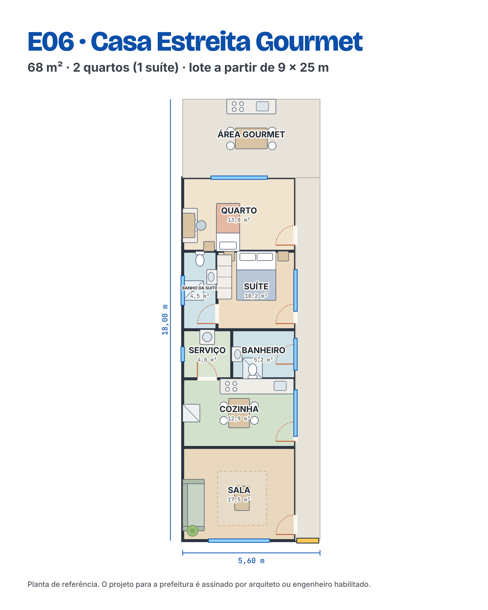

**68 m² fechados** · 2 quartos (1 suíte) · 2 banheiro(s) · lote a partir de **9 x 25 m** · frente para o **norte**

*Área gourmet nos fundos, aberta para o corredor*

**Por que esta planta é assim**

- Sol: testamos as quatro orientações para as janelas desta planta. Ela funciona melhor com a frente para o norte e pior para o sul (critério simplificado; o arquiteto confere para o clima da sua cidade). Se o seu lote for diferente, a planta pode ser espelhada ou as janelas mudadas.
- Corredor coberto ao lado: todos os cômodos abrem para ele e ganham janela, mesmo num lote estreito, sem corredor dentro de casa.
- Áreas molhadas juntas: o banheiro encosta em outra área molhada, e a tubulação pode ficar concentrada. O traçado final é do engenheiro.

- Sala tem vão de 4.6 m: o engenheiro confere laje e vigas
- Cozinha tem vão de 4.6 m: o engenheiro confere laje e vigas
- Quarto tem vão de 4.6 m: o engenheiro confere laje e vigas

## E07 · Casa Estreita 3 Quartos

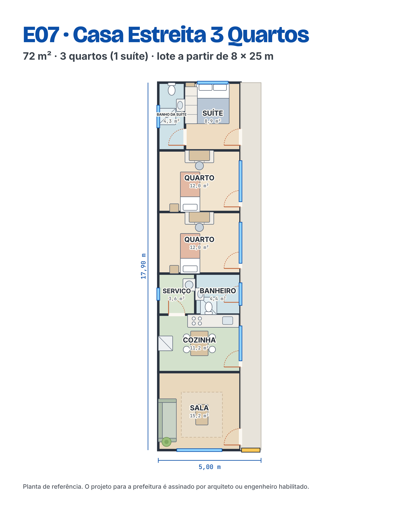

**77 m² fechados** · 3 quartos (1 suíte) · 2 banheiro(s) · lote a partir de **9 x 25 m** · frente para o **norte**

**Por que esta planta é assim**

- Sol: testamos as quatro orientações para as janelas desta planta. Ela funciona melhor com a frente para o norte e pior para o sul (critério simplificado; o arquiteto confere para o clima da sua cidade). Se o seu lote for diferente, a planta pode ser espelhada ou as janelas mudadas.
- Corredor coberto ao lado: todos os cômodos abrem para ele e ganham janela, mesmo num lote estreito, sem corredor dentro de casa.
- Áreas molhadas: o banheiro da suíte fica longe da cozinha e pede tubulação própria. Pergunte ao engenheiro quanto isso pesa no orçamento.

**Atenção**

- Banho da suíte não encosta em cozinha, serviço ou outro banheiro: prumada própria (mais cara)

## F01 · Casa Família Compacta

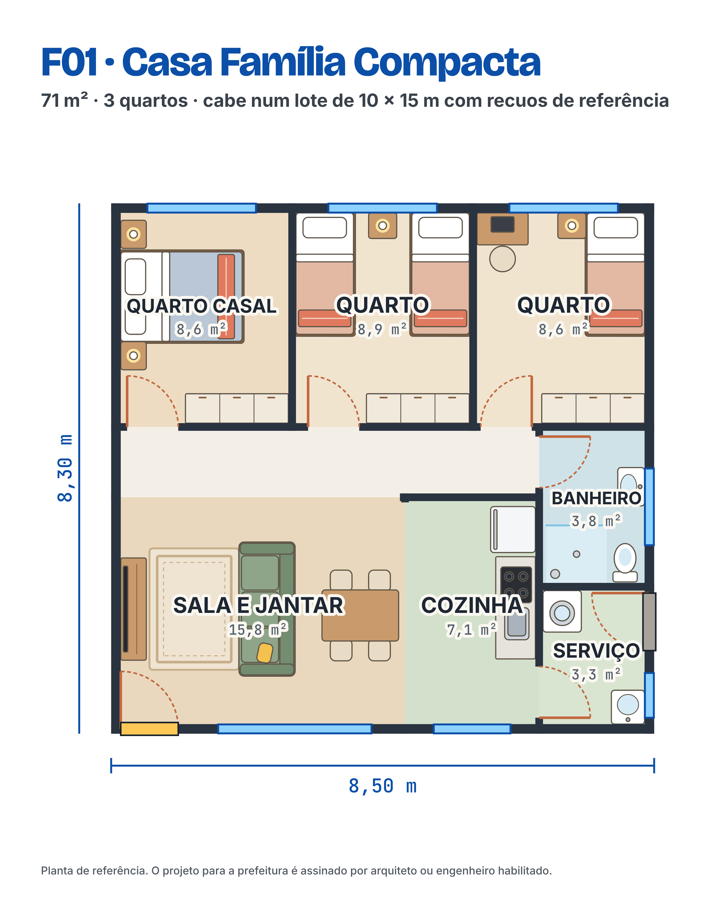

**68 m² fechados** · 3 quartos · 1 banheiro(s) · lote a partir de **10 x 15 m** · frente para o **sul**

**Por que esta planta é assim**

- Sol: testamos as quatro orientações para as janelas desta planta. Ela funciona melhor com a frente para o sul e pior para o leste (critério simplificado; o arquiteto confere para o clima da sua cidade). Se o seu lote for diferente, a planta pode ser espelhada ou as janelas mudadas.
- Luz e ar: sala, cozinha e quartos têm janela para fora, com pelo menos um sexto do piso nos cômodos de permanência (valor de referência; o código de obras da sua cidade pode pedir outro).
- Áreas molhadas juntas: o banheiro encosta em outra área molhada, e a tubulação pode ficar concentrada. O traçado final é do engenheiro.

## F02 · Casa Integrada

**86 m² fechados** · 3 quartos (1 suíte) · 2 banheiro(s) · lote a partir de **12 x 15 m** · frente para o **sul**

**Por que esta planta é assim**

- Sol: testamos as quatro orientações para as janelas desta planta. Ela funciona melhor com a frente para o sul e pior para o leste (critério simplificado; o arquiteto confere para o clima da sua cidade). Se o seu lote for diferente, a planta pode ser espelhada ou as janelas mudadas.
- Luz e ar: sala, cozinha e quartos têm janela para fora, com pelo menos um sexto do piso nos cômodos de permanência (valor de referência; o código de obras da sua cidade pode pedir outro).
- Áreas molhadas juntas: o banheiro encosta em outra área molhada, e a tubulação pode ficar concentrada. O traçado final é do engenheiro.

## F03 · Casa Família

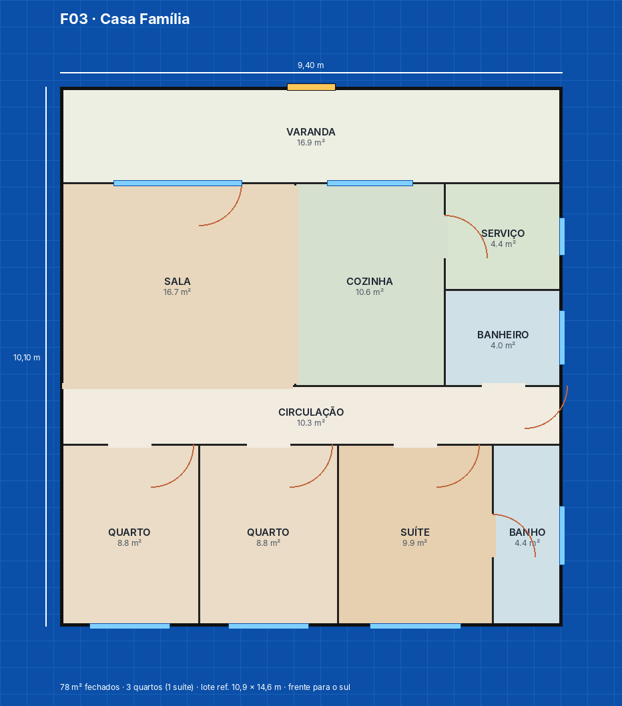

**78 m² fechados** · 3 quartos (1 suíte) · 2 banheiro(s) · lote a partir de **11 x 15 m** · frente para o **sul**

**Por que esta planta é assim**

- Sol: testamos as quatro orientações para as janelas desta planta. Ela funciona melhor com a frente para o sul e pior para o leste (critério simplificado; o arquiteto confere para o clima da sua cidade). Se o seu lote for diferente, a planta pode ser espelhada ou as janelas mudadas.
- Varanda: a porta da sala fica coberta, protegida da chuva e do sol direto.
- Áreas molhadas: o banheiro da suíte fica longe da cozinha e pede tubulação própria. Pergunte ao engenheiro quanto isso pesa no orçamento.

**Atenção**

- Banho da suíte não encosta em cozinha, serviço ou outro banheiro: prumada própria (mais cara)

## F04 · Casa Família Suíte

**80 m² fechados** · 3 quartos (1 suíte) · 2 banheiro(s) · lote a partir de **11 x 20 m** · frente para o **sul**

**Por que esta planta é assim**

- Sol: testamos as quatro orientações para as janelas desta planta. Ela funciona melhor com a frente para o sul e pior para o leste (critério simplificado; o arquiteto confere para o clima da sua cidade). Se o seu lote for diferente, a planta pode ser espelhada ou as janelas mudadas.
- Luz e ar: sala, cozinha e quartos têm janela para fora, com pelo menos um sexto do piso nos cômodos de permanência (valor de referência; o código de obras da sua cidade pode pedir outro).
- Áreas molhadas: o banheiro da suíte fica longe da cozinha e pede tubulação própria. Pergunte ao engenheiro quanto isso pesa no orçamento.

**Atenção**

- Banho da suíte não encosta em cozinha, serviço ou outro banheiro: prumada própria (mais cara)

## F05 · Casa em L

**90 m² fechados** · 3 quartos (1 suíte) · 2 banheiro(s) · lote a partir de **13 x 15 m** · frente para o **sul**

**Por que esta planta é assim**

- Sol: testamos as quatro orientações para as janelas desta planta. Ela funciona melhor com a frente para o sul e pior para o leste (critério simplificado; o arquiteto confere para o clima da sua cidade). Se o seu lote for diferente, a planta pode ser espelhada ou as janelas mudadas.
- Luz e ar: sala, cozinha e quartos têm janela para fora, com pelo menos um sexto do piso nos cômodos de permanência (valor de referência; o código de obras da sua cidade pode pedir outro).
- Áreas molhadas juntas: o banheiro encosta em outra área molhada, e a tubulação pode ficar concentrada. O traçado final é do engenheiro.

- Sala tem vão de 4.6 m: o engenheiro confere laje e vigas

## S03 · Casa Acessível

**75 m² fechados** · 2 quartos · 1 banheiro(s) · lote a partir de **11 x 15 m** · frente para o **sul**

*Sem degrau, circulação de 1,50 m, banheiro com giro de cadeira de rodas e portas largas*

**Por que esta planta é assim**

- Sol: testamos as quatro orientações para as janelas desta planta. Ela funciona melhor com a frente para o sul e pior para o leste (critério simplificado; o arquiteto confere para o clima da sua cidade). Se o seu lote for diferente, a planta pode ser espelhada ou as janelas mudadas.
- Luz e ar: sala, cozinha e quartos têm janela para fora, com pelo menos um sexto do piso nos cômodos de permanência (valor de referência; o código de obras da sua cidade pode pedir outro).
- Áreas molhadas juntas: o banheiro encosta em outra área molhada, e a tubulação pode ficar concentrada. O traçado final é do engenheiro.

## S04 · Casa Home Office

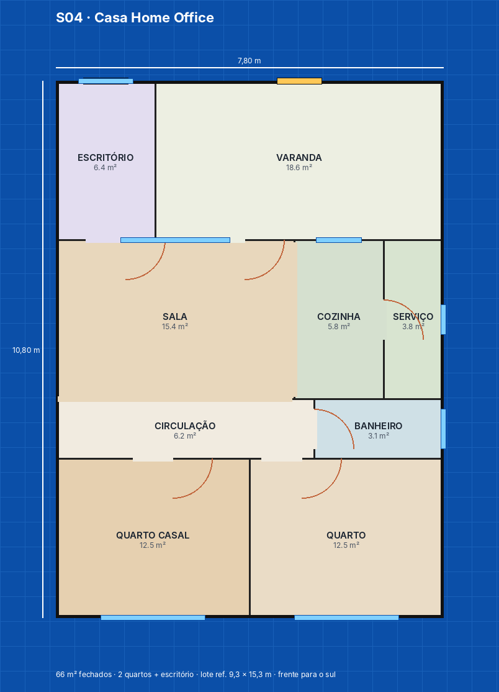

**66 m² fechados** · 2 quartos + escritório · 1 banheiro(s) · lote a partir de **10 x 20 m** · frente para o **sul**

*Escritório com porta para a rua: cliente entra sem passar pela casa*

**Por que esta planta é assim**

- Sol: testamos as quatro orientações para as janelas desta planta. Ela funciona melhor com a frente para o sul e pior para o leste (critério simplificado; o arquiteto confere para o clima da sua cidade). Se o seu lote for diferente, a planta pode ser espelhada ou as janelas mudadas.
- Varanda: a porta da sala fica coberta, protegida da chuva e do sol direto.
- Áreas molhadas juntas: o banheiro encosta em outra área molhada, e a tubulação pode ficar concentrada. O traçado final é do engenheiro.

- Sala tem vão de 4.8 m: o engenheiro confere laje e vigas

## S05 · Casa de Praia

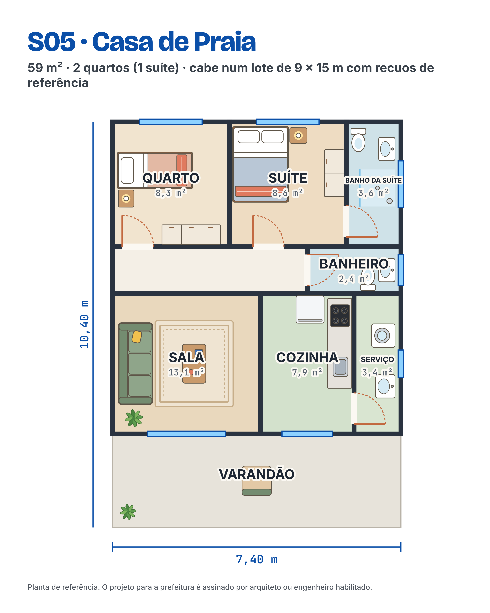

**59 m² fechados** · 2 quartos (1 suíte) · 2 banheiro(s) · lote a partir de **9 x 15 m** · frente para o **sul**

*Varandão na frente e ventilação cruzada em todos os cômodos*

**Por que esta planta é assim**

- Sol: testamos as quatro orientações para as janelas desta planta. Ela funciona melhor com a frente para o sul e pior para o leste (critério simplificado; o arquiteto confere para o clima da sua cidade). Se o seu lote for diferente, a planta pode ser espelhada ou as janelas mudadas.
- Varanda: a porta da sala fica coberta, protegida da chuva e do sol direto.
- Áreas molhadas juntas: o banheiro encosta em outra área molhada, e a tubulação pode ficar concentrada. O traçado final é do engenheiro.

## S07 · Casa Gourmet

**74 m² fechados** · 3 quartos (1 suíte) · 2 banheiro(s) · lote a partir de **11 x 15 m** · frente para o **sul**

*Cozinha aberta para a área gourmet, a casa que recebe*

**Por que esta planta é assim**

- Sol: testamos as quatro orientações para as janelas desta planta. Ela funciona melhor com a frente para o sul e pior para o leste (critério simplificado; o arquiteto confere para o clima da sua cidade). Se o seu lote for diferente, a planta pode ser espelhada ou as janelas mudadas.
- Luz e ar: sala, cozinha e quartos têm janela para fora, com pelo menos um sexto do piso nos cômodos de permanência (valor de referência; o código de obras da sua cidade pode pedir outro).
- Áreas molhadas juntas: o banheiro encosta em outra área molhada, e a tubulação pode ficar concentrada. O traçado final é do engenheiro.

## S09 · Casa de Esquina

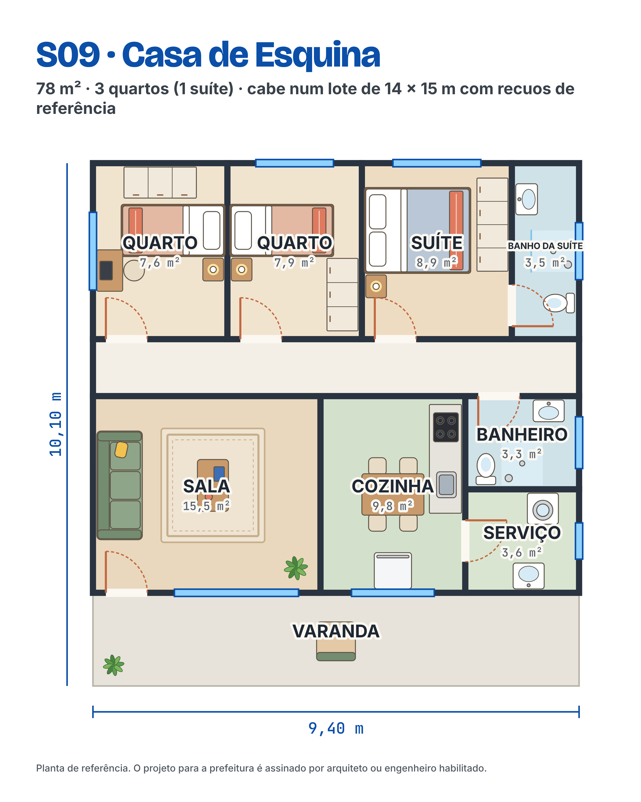

**78 m² fechados** · 3 quartos (1 suíte) · 2 banheiro(s) · lote a partir de **14 x 15 m** · frente para o **sul**

**Por que esta planta é assim**

- Sol: testamos as quatro orientações para as janelas desta planta. Ela funciona melhor com a frente para o sul e pior para o leste (critério simplificado; o arquiteto confere para o clima da sua cidade). Se o seu lote for diferente, a planta pode ser espelhada ou as janelas mudadas.
- Varanda: a porta da sala fica coberta, protegida da chuva e do sol direto.
- Áreas molhadas: o banheiro da suíte fica longe da cozinha e pede tubulação própria. Pergunte ao engenheiro quanto isso pesa no orçamento.

**Atenção**

- Banho da suíte não encosta em cozinha, serviço ou outro banheiro: prumada própria (mais cara)
